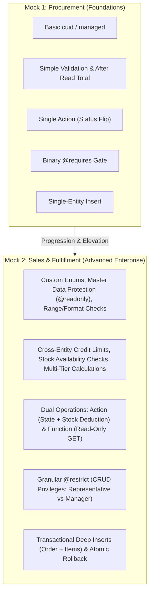

# SAP CAP Practical Mock Exam 01 vs Mock 02: In-Depth Analysis & Blueprint Guide

> **Target Certification**: SAP Certified Associate — Backend Developer — SAP Cloud Application Programming Model (`C_CPE_2409` / `C_CPE_14`)  
> **Author**: Antigravity Enterprise Architecture Team  
> **Date**: October 2026

---

## Executive Summary

The journey to earning the **SAP Certified Associate — Backend Developer (C_CPE)** credential requires practical fluency across eight core competencies: CDS data modeling, service exposure, lifecycle business logic, custom operations, declarative security, database queries/persistence, MTA build & cloud packaging, and runtime diagnostics.

- **Mock Exam 01** focused on **Procurement Management (P2P)**: Suppliers, Products, Purchase Orders, and Order Items.
- **Mock Exam 02** advances to **Sales & Customer Order Fulfillment (O2C)**: Customers, Product Catalog, Sales Orders, Order Items, Inventory Stock Allocation, and Loyalty Discounting.

This guide provides a comprehensive pedagogical analysis of your Mock 1 performance, explains how Mock 2 advances your readiness, and outlines the complete architectural blueprint for Mock 2.

---

## 1. Deep Analysis of Mock Exam 01

### What Was Successfully Implemented in Mock 1
In `/home/user/C_CPE/Mock-1`, you implemented:
1. **Domain Modeling (`db/schema.cds`)**:
   - Entities: `Suppliers`, `Products`, `PurchaseOrders`, `OrderItems`.
   - Used `cuid` and `managed` aspects.
   - Modeled an `Association to Suppliers` and a `Composition of many OrderItems on Items.order = $self`.
   - Added a `virtual total : Decimal(10,2)` field.
2. **Service Layer (`srv/procurement-service.cds`)**:
   - Exposed entities as projections.
   - Defined custom action `action submitOrder(orderID : UUID) returns { message: String }` protected with `@requires: 'ProcurementManager'`.
3. **Event Handlers (`srv/procurement-service.js`)**:
   - `before('CREATE', 'Products')`: Rejects negative price (`price < 0`).
   - `before('CREATE', 'OrderItems')`: Rejects null or non-positive quantity (`quantity < 1`).
   - `before('CREATE', 'PurchaseOrders')`: Queries supplier and rejects if inactive (`active === false`).
   - `after('READ', 'PurchaseOrders')`: Dynamically calculates order total across related items.
   - `on('submitOrder')`: Verifies order exists, validates status is `'DRAFT'`, checks that order has items, and updates status to `'SUBMITTED'`.
4. **Security & Deployment (`package.json`, `mta.yaml`, `xs-security.json`)**:
   - Mocked authentication with `manager` (`ProcurementManager`) and `employee` roles.
   - Production profile configured with HANA and XSUAA.
   - Valid `mta.yaml` with `hdb` db deployer and `nodejs` srv module.

### Strengths & Takeaways from Mock 1
- You mastered basic CAP project scaffolding and composition syntax.
- You properly utilized `cds.tx(req).run(...)` for transactional CQL queries.
- You configured the dual profile (`[development]` vs `[production]`) in `package.json`.

---

## 2. Why Mock 2 is the Critical Next Step

While Mock 1 established foundational mechanics, real-world SAP enterprise engineering and the `C_CPE` exam assess deeper patterns. Mock 2 introduces vital enterprise dimensions:



### Key Innovations in Mock Exam 02:

1. **Custom Enums and Named Types**:
   - Mock 1 used raw `String(20)` for status. Mock 2 requires formal CDS enums (`OrderStatus`, `Priority`, `LoyaltyTier`), teaching type-safe domain modeling.
2. **Master Data Immutability (`@readonly`)**:
   - Protects `Customers` from unauthorized writes via the transactional service.
3. **Cross-Entity Credit Limit Enforcement**:
   - Aggregates existing open orders across the customer account and verifies against `creditLimit`.
4. **Atomic Inventory Allocation**:
   - When `confirmSalesOrder` executes, it doesn't just change a string flag — it dynamically and atomically deducts the purchased quantities from `Products.availableStock`.
5. **Action vs Function Contrast**:
   - Mock 1 only had an Action. The C_CPE exam heavily tests knowing when to use an **Action** (POST, state mutating) vs a **Function** (GET, side-effect-free calculation). Mock 2 includes both (`confirmSalesOrder` action and `calculateCustomerDiscount` function).
6. **Granular Declarative Authorization (`@restrict`)**:
   - Goes beyond binary `@requires`. Representatives can read and create draft orders, while Managers have full modification and confirmation authority.
7. **Transactional Deep Inserts**:
   - Creating a header with nested items in a single HTTP payload and verifying atomic rollback if any child item violates business rules.

---

## 3. Detailed Comparison Matrix

| Exam Feature | Mock Exam 01 (Procurement) | Mock Exam 02 (Sales & Fulfillment) | Certification Relevance |
| :--- | :--- | :--- | :--- |
| **Domain** | Purchasing / Suppliers (MM) | Sales / Customers / Inventory (SD) | Core SAP ERP lifecycle parity |
| **Data Types** | Primitive types, String status | Custom Enums (`OrderStatus`, `Priority`) | CDS Type System mastery |
| **Master Data** | Read/Write Suppliers | `@readonly` Master Data Projections | Service exposure best practices |
| **Compositions** | Standard Composition | Composition with Cascade & Deep Insert | Parent-child containment |
| **Virtual Calculations** | Single Total calculation | Multi-tier: Item Total, Net, 10% Tax, Total | Complex after-read enrichments |
| **Inventory Impact** | No inventory tracking | Real-time stock check & atomic deduction | Enterprise transactional integrity |
| **Credit Checks** | Active supplier check only | Cumulative customer credit limit check | Cross-entity CQL aggregation |
| **Custom Operations** | 1 Action (`submitOrder`) | 1 Action (`confirmSalesOrder`) + 1 Function (`calculateCustomerDiscount`) | Complete command/query coverage |
| **Authorization** | `@requires: 'ProcurementManager'` | `@restrict` with granular CRUD grants | Enterprise role-based security |
| **Personas** | 2 personas | 3 personas (`rep`, `manager`, `unauthorized`) | Role testing & matrix verification |
| **Rollback Verification** | Single check | Deep insert atomic rollback | Database transaction resilience |

---

## 4. Technical Blueprint for Mock 2

### A. Domain Model Blueprint (`db/schema.cds`)
```cds
namespace sales;

using { cuid, managed } from '@sap/cds/common';

type OrderStatus : String enum {
    DRAFT;
    CONFIRMED;
    IN_DELIVERY;
    DELIVERED;
    CANCELLED;
}

type Priority : String enum {
    LOW;
    MEDIUM;
    HIGH;
    URGENT;
}

type LoyaltyTier : String enum {
    SILVER;
    GOLD;
    PLATINUM;
}

entity Customers : cuid, managed {
    customerNumber : String(20) not null;
    name           : String(100) not null;
    email          : String(255);
    creditLimit    : Decimal(12,2) default 10000.00;
    loyaltyTier    : LoyaltyTier default 'SILVER';
    active         : Boolean default true;
    orders         : Association to many SalesOrders on orders.customer = $self;
}

entity Products : cuid, managed {
    productCode    : String(20) not null;
    name           : String(100) not null;
    description    : String(500);
    category       : String(50);
    unitPrice      : Decimal(10,2) not null;
    availableStock : Integer default 0;
}

entity SalesOrders : cuid, managed {
    orderNumber     : String(20) not null;
    orderDate       : Date;
    deliveryDate    : Date;
    status          : OrderStatus default 'DRAFT';
    priority        : Priority default 'MEDIUM';
    shippingAddress : String(255);
    customer        : Association to Customers;
    Items           : Composition of many OrderItems on Items.order = $self;
    
    // Virtual non-persisted fields computed in after-read
    virtual netAmount   : Decimal(12,2);
    virtual taxAmount   : Decimal(12,2);
    virtual totalAmount : Decimal(12,2);
}

entity OrderItems : cuid {
    order       : Association to SalesOrders;
    product     : Association to Products;
    itemNumber  : Integer default 10;
    quantity    : Integer not null default 1;
    unitPrice   : Decimal(10,2) not null;
    discountPct : Decimal(5,2) default 0.00;
    
    virtual itemTotal : Decimal(12,2);
}
```

---

### B. Service Definition Blueprint (`srv/sales-service.cds`)
```cds
using sales as db from '../db/schema';

service SalesService @(path: '/odata/v4/sales') {

    @readonly
    entity Customers as projection on db.Customers;

    entity Products as projection on db.Products;

    @restrict: [
        { grant: ['READ', 'CREATE'], to: 'SalesRepresentative' },
        { grant: ['*'],              to: 'SalesManager' }
    ]
    entity SalesOrders as projection on db.SalesOrders;

    entity OrderItems as projection on db.OrderItems;

    @requires: 'SalesManager'
    action confirmSalesOrder(orderID : UUID) returns {
        success     : Boolean;
        orderNumber : String;
        status      : String;
        message     : String;
    };

    function calculateCustomerDiscount(customerID : UUID, orderAmount : Decimal(10,2)) returns {
        loyaltyTier     : String;
        discountRate    : Decimal(5,2);
        discountSavings : Decimal(10,2);
        finalAmount     : Decimal(10,2);
    };
}
```

---

### C. Business Logic Architecture (`srv/sales-service.js`)
```javascript
const cds = require('@sap/cds');

module.exports = cds.service.impl(async function() {
    const { Customers, Products, SalesOrders, OrderItems } = this.entities;

    // 1. Line Item Validation (Quantity & Discount)
    this.before(['CREATE', 'UPDATE'], 'OrderItems', async (req) => {
        const { quantity, discountPct, product_ID } = req.data;

        if (quantity == null || quantity < 1) {
            return req.error(400, 'Order item quantity must be at least 1.');
        }

        if (discountPct != null && (discountPct < 0 || discountPct > 30.00)) {
            return req.error(400, 'Discount percentage must be between 0.00% and 30.00%.');
        }

        if (product_ID) {
            const product = await cds.tx(req).run(SELECT.one.from(Products).where({ ID: product_ID }));
            if (!product) return req.error(404, 'Product not found.');
            if (product.availableStock < quantity) {
                return req.error(400, `Insufficient stock for product '${product.name}'. Available: ${product.availableStock}, Requested: ${quantity}`);
            }
        }
    });

    // 2. Sales Order Validation (Customer Active & Credit Limit)
    this.before('CREATE', 'SalesOrders', async (req) => {
        const customerID = req.data.customer_ID || req.data.customer?.ID;
        if (!customerID) return req.error(400, 'A valid customer is required.');

        const customer = await cds.tx(req).run(SELECT.one.from(Customers).where({ ID: customerID }));
        if (!customer) return req.error(404, 'Customer not found.');
        if (customer.active === false) {
            return req.error(400, 'Cannot place orders for an inactive customer.');
        }

        // Calculate potential total of new order items if present
        if (req.data.Items && req.data.Items.length > 0) {
            const newOrderTotal = req.data.Items.reduce((acc, item) => {
                const qty = item.quantity || 1;
                const price = item.unitPrice || 0;
                const disc = item.discountPct || 0;
                return acc + (qty * price * (1 - disc / 100));
            }, 0);

            // Fetch customer's active unpaid orders
            const openOrders = await cds.tx(req).run(
                SELECT.from(SalesOrders).where({ customer_ID: customerID, status: { in: ['DRAFT', 'CONFIRMED', 'IN_DELIVERY'] } })
            );

            // In production, aggregate total; check against credit limit
            if (newOrderTotal > Number(customer.creditLimit)) {
                return req.error(400, `Order total (${newOrderTotal.toFixed(2)}) exceeds customer credit limit (${customer.creditLimit}).`);
            }
        }
    });

    // 3. Dynamic Calculation of Virtual Amounts in After-Read
    this.after('READ', 'SalesOrders', async (orders, req) => {
        const orderList = Array.isArray(orders) ? orders : [orders];

        for (const order of orderList) {
            if (!order || !order.ID) continue;

            const items = await cds.tx(req).run(
                SELECT.from(OrderItems).where({ order_ID: order.ID })
            );

            let net = 0;
            for (const item of items) {
                const qty = Number(item.quantity) || 0;
                const price = Number(item.unitPrice) || 0;
                const disc = Number(item.discountPct) || 0;
                const lineTotal = qty * price * (1 - disc / 100);
                item.itemTotal = lineTotal.toFixed(2);
                net += lineTotal;
            }

            const tax = net * 0.10;
            order.netAmount = net.toFixed(2);
            order.taxAmount = tax.toFixed(2);
            order.totalAmount = (net + tax).toFixed(2);
        }
    });

    // 4. Custom Action: confirmSalesOrder
    this.on('confirmSalesOrder', async (req) => {
        const { orderID } = req.data;
        if (!orderID) return req.error(400, 'Order ID is required.');

        const order = await cds.tx(req).run(SELECT.one.from(SalesOrders).where({ ID: orderID }));
        if (!order) return req.error(404, 'Sales order not found.');

        if (order.status !== 'DRAFT') {
            return req.error(400, `Cannot confirm order in status '${order.status}'. Only DRAFT orders may be confirmed.`);
        }

        const items = await cds.tx(req).run(SELECT.from(OrderItems).where({ order_ID: orderID }));
        if (items.length === 0) {
            return req.error(400, 'Cannot confirm an order containing zero line items.');
        }

        // Atomically deduct inventory stock
        for (const item of items) {
            const product = await cds.tx(req).run(SELECT.one.from(Products).where({ ID: item.product_ID }));
            if (!product || product.availableStock < item.quantity) {
                return req.error(400, `Stock reservation failed for product ${item.product_ID}.`);
            }
            await cds.tx(req).run(
                UPDATE(Products)
                    .set({ availableStock: product.availableStock - item.quantity })
                    .where({ ID: item.product_ID })
            );
        }

        // Update status to CONFIRMED
        await cds.tx(req).run(
            UPDATE(SalesOrders).set({ status: 'CONFIRMED' }).where({ ID: orderID })
        );

        return {
            success: true,
            orderNumber: order.orderNumber,
            status: 'CONFIRMED',
            message: 'Sales order confirmed and inventory allocated successfully.'
        };
    });

    // 5. Custom Function: calculateCustomerDiscount
    this.on('calculateCustomerDiscount', async (req) => {
        const { customerID, orderAmount } = req.data;
        if (!customerID || orderAmount == null) {
            return req.error(400, 'customerID and orderAmount parameters are required.');
        }

        const customer = await cds.tx(req).run(SELECT.one.from(Customers).where({ ID: customerID }));
        if (!customer) return req.error(404, 'Customer not found.');

        let discountRate = 5.00;
        if (customer.loyaltyTier === 'GOLD') discountRate = 10.00;
        if (customer.loyaltyTier === 'PLATINUM') discountRate = 15.00;

        const discountSavings = Number(orderAmount) * (discountRate / 100);
        const finalAmount = Number(orderAmount) - discountSavings;

        return {
            loyaltyTier: customer.loyaltyTier,
            discountRate: discountRate.toFixed(2),
            discountSavings: discountSavings.toFixed(2),
            finalAmount: finalAmount.toFixed(2)
        };
    });
});
```

---

## 5. Executable cURL Test Suite

```bash
# 1. Metadata check
curl -s http://localhost:4004/odata/v4/sales/\$metadata

# 2. Query Customers (Read-Only)
curl -u rep:rep123 http://localhost:4004/odata/v4/sales/Customers

# 3. Create Deep Sales Order with Items
curl -i -X POST http://localhost:4004/odata/v4/sales/SalesOrders \
  -u rep:rep123 \
  -H "Content-Type: application/json" \
  -d '{
    "orderNumber": "SO-2026-001",
    "orderDate": "2026-10-16",
    "customer_ID": "<CUSTOMER_UUID>",
    "shippingAddress": "100 SAP Boulevard, Walldorf",
    "Items": [
      {
        "itemNumber": 10,
        "quantity": 2,
        "unitPrice": 499.00,
        "discountPct": 5.00,
        "product_ID": "<PRODUCT_UUID>"
      }
    ]
  }'

# 4. Verify Computed Totals ($expand=Items)
curl -s "http://localhost:4004/odata/v4/sales/SalesOrders?<UUID>?\$expand=Items" -u rep:rep123 | jq .

# 5. Call Custom Function (Calculate Customer Discount)
curl -s "http://localhost:4004/odata/v4/sales/calculateCustomerDiscount(customerID=<CUSTOMER_UUID>,orderAmount=1000.00)" \
  -u rep:rep123 | jq .

# 6. Negative Test: Unauthorized Action execution (Rep fails)
curl -i -X POST http://localhost:4004/odata/v4/sales/confirmSalesOrder \
  -u rep:rep123 \
  -H "Content-Type: application/json" \
  -d '{"orderID": "<ORDER_UUID>"}'
# Expect: HTTP 403 Forbidden

# 7. Positive Test: Authorized Action execution (Manager succeeds)
curl -i -X POST http://localhost:4004/odata/v4/sales/confirmSalesOrder \
  -u manager:mgr123 \
  -H "Content-Type: application/json" \
  -d '{"orderID": "<ORDER_UUID>"}'
# Expect: HTTP 200 OK + status: 'CONFIRMED'
```

---

## 6. Project Setup & Workspace Organization

All Mock 2 assets have been organized in your workspace:

- **PDF Question Paper**: [SAP_CAP_Practical_Mock_Exam_02.pdf](file:///home/user/C_CPE/SAP_CAP_Practical_Mock_Exam_02.pdf)
- **Markdown Question Paper**: [SAP_CAP_Practical_Mock_Exam_02.md](file:///home/user/C_CPE/SAP_CAP_Practical_Mock_Exam_02.md)
- **Dedicated Project Directory**: `/home/user/C_CPE/Mock-2/` (ready with scaffolded structure)
